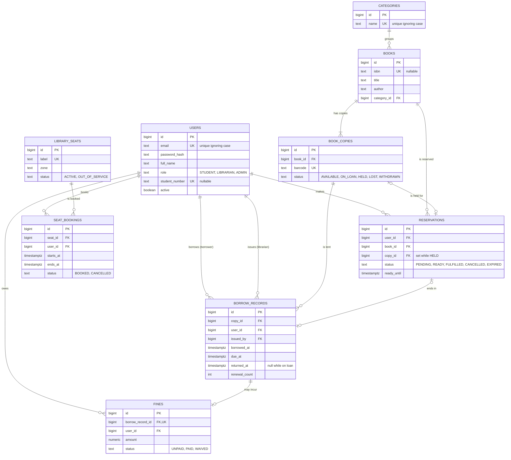

# Database design

ChapelBook uses PostgreSQL 16. The schema is owned by Flyway migrations
(`backend/src/main/resources/db/migration`); Hibernate only checks at startup that the entities match
it (`ddl-auto: validate`). Every rule that must never be broken is enforced **in the database as well
as in the Java code**, so a bug, a second application or a concurrent request cannot corrupt the data.

## Entity relationship diagram

## Book versus copy

A **book** is a title (what the catalogue shows, what a student searches for and reserves). A
**book copy** is one physical item with its own barcode (what is actually lent, returned, lost or
withdrawn). The library may own three copies of one title. Availability is "how many copies of this
book have status `AVAILABLE`". Keeping the two apart is what makes "reserve this title" and "lend
this barcode" both simple and correct.

## Rules the database enforces

| Rule | Mechanism | Migration |
| --- | --- | --- |
| Email is unique regardless of capitalisation | unique index on `lower(email)` | V2 |
| Role, copy status, reservation status, fine status and seat status only hold known values | `CHECK (status IN (...))` | V2 to V4 |
| A copy can have **only one open loan** (cannot be lent twice) | partial unique index on `borrow_records(copy_id) WHERE returned_at IS NULL` | V3 |
| A student cannot hold **two active reservations for the same book** | partial unique index on `reservations(user_id, book_id) WHERE status IN ('PENDING','READY')` | V3 |
| A copy is held for **at most one** reservation | partial unique index on `reservations(copy_id) WHERE status = 'READY'` | V3 |
| A `READY` reservation always names its copy and a deadline | `CHECK` tying `status`, `copy_id` and `ready_until` together | V3 |
| Dates make sense (due after borrowed, returned not before borrowed) | `CHECK` constraints | V3 |
| One fine per loan, never negative | `UNIQUE (borrow_record_id)` and `CHECK (amount > 0)` | V3 |
| A paid fine records when it was paid | `CHECK (status <> 'PAID' OR paid_at IS NOT NULL)` | V3 |
| **A seat cannot be double booked** | `EXCLUDE USING gist (seat_id WITH =, tstzrange(starts_at, ends_at) WITH &&) WHERE (status = 'BOOKED')` | V4 |
| **A student cannot book two overlapping seats** | the same exclusion constraint on `user_id` | V4 |
| A booking ends after it starts and lasts at most 8 hours | `CHECK` constraints | V4 |

### Why an exclusion constraint for seats

"Is the seat free?" followed by "insert the booking" is a classic race: two students can both see
the seat free and both insert. Application-level checks cannot close that gap without locking. A
PostgreSQL exclusion constraint closes it inside the database: the second insert fails with
`23P01 exclusion_violation`, and the service turns that into a clean `409 Conflict`. It needs the
`btree_gist` extension (enabled in V1) so a GiST index can compare a plain column (`seat_id`) and a
time range (`&&` means overlaps) together. Cancelled bookings are excluded by the `WHERE` clause, so
a cancelled slot can be booked again. Ranges are half-open, so a booking ending at 10:00 and
another starting at 10:00 do not clash.

### Why partial unique indexes for loans and reservations

"At most one open loan per copy" is a rule about a *subset* of rows (loans not yet returned).
A normal unique constraint would forbid ever borrowing the same copy twice. A partial unique index
`WHERE returned_at IS NULL` applies the rule only to open loans, which is exactly the rule. The same
idea prevents duplicate active reservations while still allowing a student to reserve the same book
again after cancelling.

## Other design decisions

- **Text plus `CHECK` instead of PostgreSQL enums.** Adding a status later is a one-line constraint
  change rather than an `ALTER TYPE`, and JPA maps it with `@Enumerated(EnumType.STRING)`.
- **`timestamptz` everywhere**, stored in UTC. The API sends and receives ISO-8601 instants.
- **Identity primary keys (`bigint`).** Simple and fast. Resources are always authorised by role and
  ownership in the service layer, so ids are not treated as secrets.
- **Optimistic locking (`version`)** on books and copies, so two librarians editing the same record
  do not silently overwrite each other. Operations that must never conflict (lending a copy,
  booking a seat) rely on the constraints above and, where needed, a row lock.
- **Fines are stored, not recomputed.** A fine is created when an overdue book is returned, using the
  rate in effect then, so changing the rate later does not rewrite history. Money is `NUMERIC(10,2)`.
- **Soft retirement over deletion.** Copies are `WITHDRAWN` and users are deactivated rather than
  deleted, and foreign keys stay `RESTRICT`, so borrowing history is never lost.
- **Trigram indexes (`pg_trgm`)** on book title and author make "contains" search indexable.
  A `LIKE '%word%'` query would otherwise scan the whole table.
- **Indexes follow the queries**: copies by book and status (availability), loans by user (my
  borrowings), open loans by due date (overdue report), reservations by book and queue order,
  bookings by seat and time.

## Migrations

| Version | Purpose |
| --- | --- |
| V1 | Enable `btree_gist` and `pg_trgm` |
| V2 | `users`, `categories`, `books`, `book_copies` |
| V3 | `reservations`, `borrow_records`, `fines` |
| V4 | `library_seats`, `seat_bookings` |

Migrations are never edited after they are committed; a fix is a new migration.
